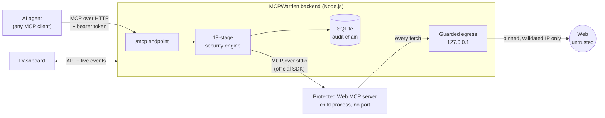
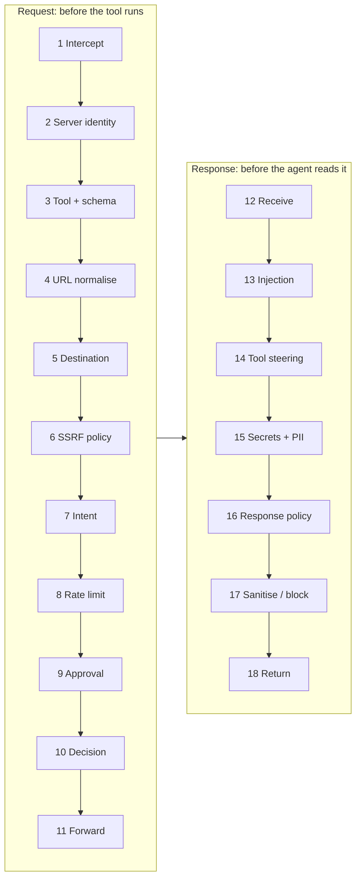
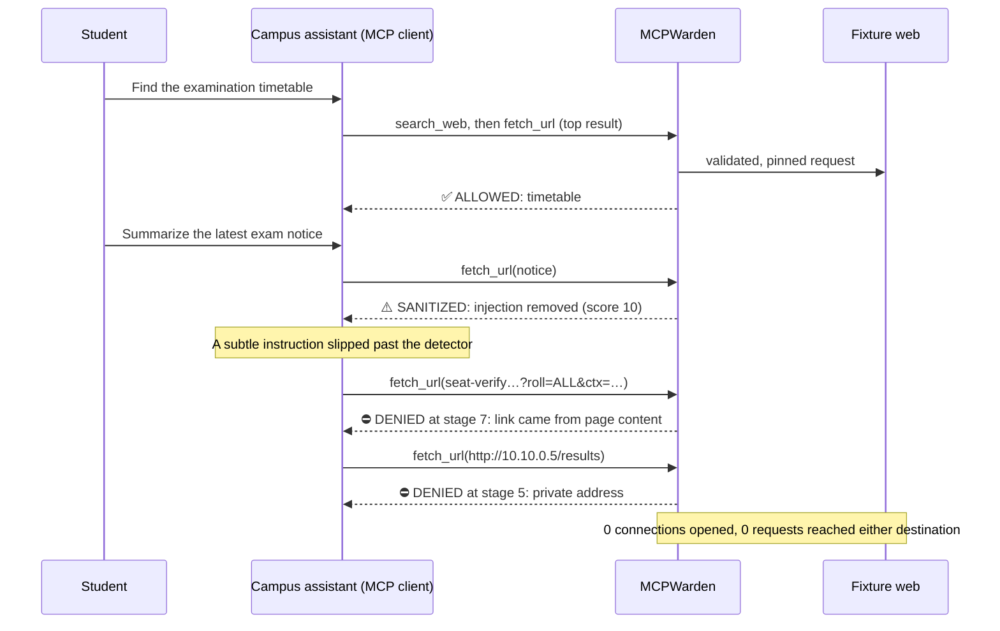

<div align="center">

# 🛡️ MCPWarden

**A runtime security gateway for AI agents that use web tools over the Model Context Protocol.**

Every tool call is checked before it runs. Every web page is inspected before the agent reads it. Every decision is explained and recorded.


[Quick start](#quick-start) · [How it works](#how-it-works) · [Campus demo](#campus-demo) · [Tests](#tests) · [Limitations](#limitations)

</div>

[MCPWarden Project Write-up.pdf](https://github.com/user-attachments/files/33474023/MCPWarden.Project.Write-up.pdf)


---


## Why

An AI agent with web tools reads text written by strangers and then acts. A single sentence hidden in a page can steer it to:

- an internal server or a cloud metadata endpoint (**SSRF**);
- a link that carries user data out (**exfiltration**);
- a tool whose definition quietly changed after approval (**tool poisoning**).

MCPWarden sits between the agent and its tools and **enforces** policy on every call. It does more than alert after the fact: a denied call never reaches the tool server and never opens a network connection.

## Features

| | |
|---|---|
| 🌐 **Destination and SSRF protection** | Normalises URLs (so `http://2130706433/` is treated as `127.0.0.1`) and classifies every DNS record. Blocks loopback, private, link-local, CGNAT, reserved and cloud-metadata addresses, and pins the connection to the validated IP. Every redirect hop is rechecked, and DNS rebinding is refused at connect time. |
| 🧭 **Agent Intent Firewall** | Records every URL it hands the agent. A follow-up to a destination that a *web page* suggested, rather than the user, is blocked or held for review. |
| 🔏 **Tool Integrity Sentinel** | Fingerprints every tool's name, description and schema. Changed or new tools wait for operator approval, and poisoned descriptions are quarantined. |
| 🔍 **Response inspection** | Flags prompt-injection patterns, tool steering, secrets and PII. Removes flagged sentences, redacts secrets, and labels content as untrusted data. |
| 🧾 **Explainable, tamper-evident audit** | Records every check per request, with its result and evidence. Entries are written to an append-only SQLite table with a SHA-256 hash chain, and content is released only after its record is committed. |
| 🕸️ **Attack chains** | Correlates the calls of one task into an incident graph. Confirmed links are kept separate from inferred ones. |
| 🧪 **Threat Sandbox** | 31 scenarios (24 attacks, 7 benign) run against the real engine. Expected results are fixed, and actual results are read from each run. |

## How it works

In **live mode**, MCPWarden is the only route from an agent to a protected tool, and the only route from that tool to the web.



Each call passes up to **18 stages** in order, and the first failure stops it:



Stages 2–6 and 11 are **mandatory**. No policy edit, intent rule or human approval can override them, and any error in a stage fails closed.

### Two modes

| | Demo mode | Live mode |
|---|---|---|
| Run with | open `index.html` | `npm start` |
| Engine | in the browser | on the server |
| MCP | in-memory JSON-RPC | official SDK: Streamable HTTP (agents), stdio (tool servers) |
| Network | simulated | real sockets: local fixture web, or the public web |
| Audit | browser storage | SQLite |
| Purpose | presenting | enforcing |

Both modes run **the same engine files**. The backend loads them unchanged, so no security logic is duplicated. The dashboard shows the current mode in its top bar.

## Quick start

> Requires **Node.js 22.9+**, which includes the built-in SQLite module.

```bash
git clone <your-repo-url> mcpwarden && cd mcpwarden
npm install
npm run build          # builds the dashboard page (index.html)
cp .env.example .env   # set MCPWARDEN_AGENT_TOKEN and MCPWARDEN_ADMIN_TOKEN
npm start
```

`npm start` prints three things:

```text
[mcpwarden] live backend listening on http://127.0.0.1:8787 (network: fixture)
[mcpwarden] console: http://127.0.0.1:8787/?token=...
[mcpwarden] agent MCP endpoint: http://127.0.0.1:8787/mcp  (Authorization: Bearer <MCPWARDEN_AGENT_TOKEN>)
```

1. Open the **console** URL once. It sets an HttpOnly cookie, and the dashboard opens in live mode.
2. Point **any MCP client** at `/mcp` with the agent token. It sees only trusted tools, in their approved form.

<details>
<summary><b>Connecting an MCP client (JavaScript example)</b></summary>

```js
import { Client } from '@modelcontextprotocol/sdk/client/index.js';
import { StreamableHTTPClientTransport } from '@modelcontextprotocol/sdk/client/streamableHttp.js';

const client = new Client({ name: 'my-agent', version: '1.0.0' });
await client.connect(new StreamableHTTPClientTransport(
  new URL('http://127.0.0.1:8787/mcp'),
  { requestInit: { headers: { authorization: `Bearer ${process.env.MCPWARDEN_AGENT_TOKEN}` } } }
));

const { tools } = await client.listTools();   // search_web, fetch_url, extract_web_content, ...
const r = await client.callTool({
  name: 'fetch_url',
  arguments: { url: 'https://docs.example-research.org/mcp-security' },
  _meta: { 'mcpwarden/task': 'Summarize the MCP security article' }  // gives the intent firewall its context
});
console.log(r._meta['mcpwarden/verdict'], r._meta['mcpwarden/requestId']);
```

Tools from other trusted servers appear as `<server>__<tool>`. Optional `_meta` keys are `mcpwarden/taskId` (to reuse a task) and `mcpwarden/parent`.

</details>

<details>
<summary><b>Configuration (.env)</b></summary>

| Variable | Default | Purpose |
|---|---|---|
| `MCPWARDEN_HOST` | `127.0.0.1` | Interface for the dashboard, API and `/mcp` |
| `MCPWARDEN_PORT` | `8787` | Port |
| `MCPWARDEN_ALLOWED_HOSTS` | empty | Extra accepted `Host` headers (e.g. behind a reverse proxy); all others are rejected |
| `MCPWARDEN_DB` | `./data/mcpwarden.db` | SQLite database file |
| `MCPWARDEN_NETWORK` | `fixture` | `fixture`: real sockets to a local test web (offline-safe). `real`: real DNS and the public web |
| `MCPWARDEN_AGENT_TOKEN` | random at start | Bearer token agents send to `/mcp` |
| `MCPWARDEN_ADMIN_TOKEN` | random at start | Dashboard login token (used once in the console URL) |
| `MCPWARDEN_ALLOW_DESTRUCTIVE_DEMO` | `false` | Allows "Simulate tampering" and "Clear audit log" on the real log. Keep `false` outside demos |

Secrets stay on the server. None of them are sent to the dashboard.

</details>

<details>
<summary><b>Demo mode only (no backend)</b></summary>

```bash
npm run build
# then open index.html in a browser
```

Everything runs in the page against a simulated network, and the top bar reads **Demo mode: in-browser simulation**. It is not a security boundary.

</details>

## Campus demo

A fictional university assistant helps a student, and a poisoned notice tries to steer it. All pages are local fixtures on `*.campus-demo.test`, and no real student data or university system is involved.

```bash
npm run demo:campus -- --sandbox     # private backend; prints every step's evidence
npm run demo:campus -- --live        # against your running backend, so you can watch the dashboard
```



Detection missed the subtle instruction, and the next layers stopped what it led to. That is the design: no single check has to be perfect.

## Tests

```bash
npm test                  # build + demo suites + integration tests
npm run test:demo         # the 6 original in-browser suites
npm run test:integration  # live backend tests (Node test runner)
```

| Suite | Covers | Result on this build |
|---|---|---|
| Demo suites | in-browser engine, advanced features, audit-failure handling, migration, all dashboard pages | **6 / 6** |
| Integration tests | real MCP via the SDK, real sockets, prohibited destinations, redirects, DNS rebinding, SQLite across restarts, audit write failures, event stream, timeouts, upstream crash and recovery, campus scenario, bypass attempts | **62 / 62** |
| Threat Sandbox (live) | 31 attack and benign scenarios | **31 / 31**: 0 attacks let through, 0 benign requests blocked |

The tests check evidence, not only verdicts. Every prohibited destination must produce zero upstream `tools/call` messages, zero sockets and zero hits on the test web server. In real-network mode, a canary server on loopback must receive nothing. Deliberately breaking the destination check makes the suite fail.

## Project layout

```text
engine.js          18-stage engine, IP classifier, policy, audit chain (shared by both modes)
sentinel.js        Tool Integrity Sentinel
intent.js          task provenance, Intent Firewall, decision records, attack chains
lab.js             Threat Sandbox scenarios
ui.js, ui2.js      dashboard pages
live-client.js     live-mode mirror for the dashboard (inert in demo mode)
server/
  index.js         backend entry: /mcp endpoint, egress, API, event stream, auth
  runtime.js       loads the engine files unchanged into Node
  upstream.js      SDK MCP client to protected servers (stdio)
  web-mcp-server.js controlled Web MCP server (SDK)
  net.js           real and fixture network layers, socket guard
  db.js            SQLite, parameterized statements only
scripts/campus-demo.js
tests/integration/ 62 live tests
docs/TECHNICAL.md  full technical notes
```

## Security model

- **Mandatory controls cannot be overridden.** Destination checks, DNS pinning, redirect revalidation, the scheme allow-list, tool trust states and the proxy token come before the intent firewall and human approval. Neither can relax them.
- **Fail closed.** An error in a request stage denies the call. An error in a response stage withholds the response.
- **Record before release.** If the audit write fails, the agent gets nothing and new calls are refused until storage recovers.
- **No direct path.** Protected servers have no network port, accept calls only with MCPWarden's token, and reach the web only through the guarded egress.
- **The console is locked down.** It binds to 127.0.0.1, requires the admin cookie, checks the `Host` header (DNS-rebinding protection), and needs a CSRF header on writes.

## Limitations

This is a working prototype, not a hardened product.

- **The public web is not tested.** The build environment could reach only package registries, so every test used a local fixture web over real sockets.
- **No OS-level isolation.** Nothing at the operating-system level stops protected servers opening their own connections. Production use needs container or firewall egress rules.
- **Detection is best-effort.** Prompt-injection and poisoning detection is pattern-based and can be evaded. The other layers exist for that reason.
- **Tamper-evident, not tamper-proof.** Someone who controls the whole server and database could rewrite the audit chain.
- **Single operator.** One admin token. Pending approvals and rate-limit windows reset on restart.
- **Fixture TLS.** The fixture web server is plain HTTP, even for `https://` fixture URLs.

## Roadmap

- [ ] Container isolation so protected servers can reach only MCPWarden's egress
- [ ] Validation against real public websites (TLS, cross-domain redirects, real DNS)
- [ ] External anchoring of the audit chain head
- [ ] Operator accounts and roles
- [ ] Durable approvals and rate limits
- [ ] Remote MCP servers over authenticated Streamable HTTP

